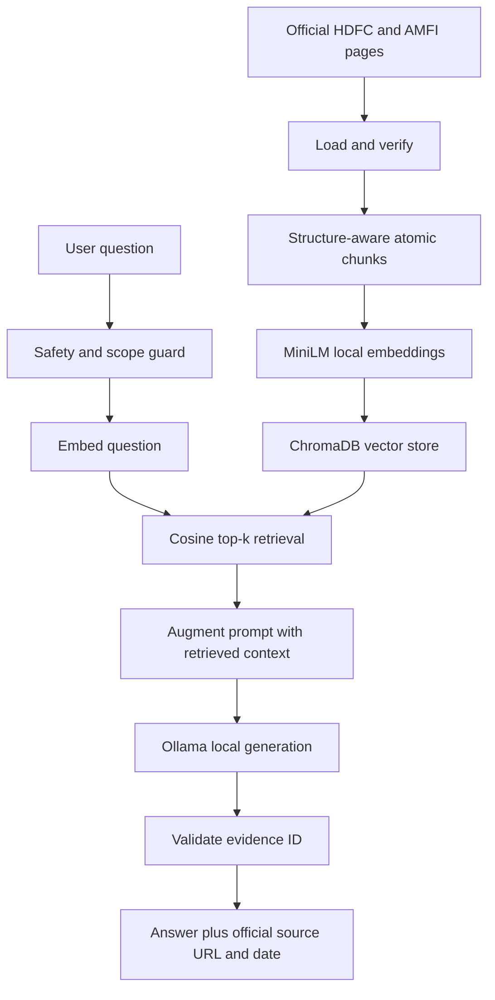

# Class-aligned vector RAG - no API key

This implementation follows the exact mental model from the NextLeap RAG lessons: **load, chunk, embed, store, retrieve, augment and generate**. It uses local open-source models, so neither a paid nor a free API key is required.

## Architecture



## How the class concepts map to this project

| Class concept | Project implementation | Why it matters |
|---|---|---|
| Load documents | `collect_sources.py` and the verified source snapshot | Uses only allowlisted official HDFC/AMFI pages |
| Chunking | `build_corpus.py` creates 41 one-fact records | One chunk covers one retrievable fact instead of mixing topics |
| Embeddings | `sentence-transformers/all-MiniLM-L6-v2` | Local 384-dimensional semantic vectors; no API key |
| Vector database | Persistent ChromaDB collection | Stores IDs, vectors, fact text and citation metadata |
| Similarity search | Cosine-distance query with top-k results | Finds related wording even when keywords differ |
| Augmentation | `build_prompt()` inserts only retrieved chunks | The model sees a small, auditable context window |
| Generation | Local `qwen3:4b` through Ollama | Produces a short answer without a hosted AI service |
| Citations | Model selects a retrieved evidence ID; code attaches its URL | Prevents the model from inventing a citation URL |
| Guardrails | Existing 66-case-tested safety boundary runs first | Blocks advice, performance, PII and unsupported requests |

## Why the chunks are curated

The source documents include marketing language, performance tables, navigation text and multiple unrelated facts. The milestone forbids performance claims and advice. The ingestion process therefore converts verified source passages into small, paraphrased, one-fact chunks while retaining the source ID, official URL, scheme, plan, topic, evidence locator and observation date. This is structure-aware chunking, which the class slides describe as preferable when documents have meaningful sections.

## Windows setup

Install Python 3.10+, Node.js 18+ and [Ollama](https://ollama.com/download). Open PowerShell in the unzipped project folder and run:

```powershell
python -m venv .venv
.\.venv\Scripts\Activate.ps1
python -m pip install -r requirements-local-rag.txt
ollama pull qwen3:4b
python class_style_rag.py --index
python class_style_rag.py "What is the exit load for HDFC Flexi Cap Fund?"
```

The first embedding-model download and Ollama model download require internet access. After the models are on the computer, indexing and questions run locally. No API key or per-request API fee is involved.

To rebuild the vector database after changing the corpus:

```powershell
python class_style_rag.py --rebuild
```

## What happens for one question

1. The tested boundary checks the question for PII, advice, performance, prompt injection, unsupported AMCs and missing scheme/plan context.
2. MiniLM converts the accepted question into a normalized 384-dimensional vector.
3. ChromaDB retrieves the five nearest fact chunks using cosine distance.
4. The prompt contains only those five chunks, their IDs, titles and dates.
5. Ollama returns a two-sentence answer and exactly one retrieved evidence ID, or `ABSTAIN`.
6. Python rejects an unknown evidence ID and programmatically attaches the official URL and source date belonging to the selected chunk.

## Two included prototype modes

- `MF_Facts_Offline.html` is the evaluator-friendly browser demo. It runs immediately and uses BM25 over the same reviewed corpus because a static file cannot run Python, MiniLM, ChromaDB or Ollama.
- `class_style_rag.py` is the full class-aligned vector RAG. It demonstrates embeddings, cosine similarity, a vector database, prompt augmentation and local LLM generation.

Do not claim that the hosted browser website runs ChromaDB or Ollama. Demonstrate the terminal command if the evaluator specifically asks to see the complete vector-RAG pipeline.

## n8n decision

The n8n slides describe workflow orchestration: webhooks, integrations, schedules and approval flows. It is not needed for this self-contained Milestone 4 FAQ. It becomes directly relevant in Milestone 5, where the brief explicitly asks for MCP, approval, internal-tool logging and an email draft.

## Known limits

- The vector index covers a reviewed snapshot, not live financial data.
- A local model must be downloaded before generated answers can run.
- Retrieval similarity does not guarantee factual relevance; the evidence-ID constraint and abstention reduce, but do not eliminate, model error.
- The browser demo and vector script are deliberately separate because reviewer computers may not have local AI dependencies.
