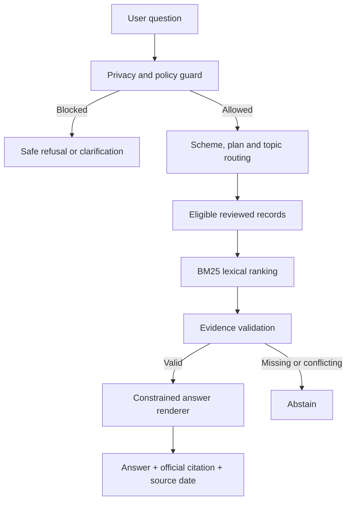
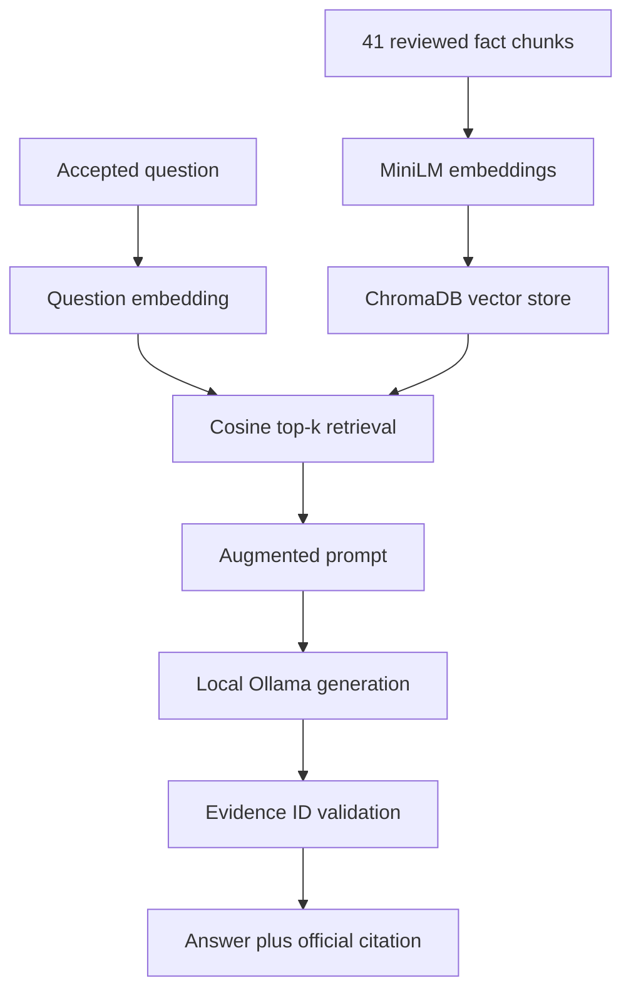

# Milestone 4 — Detailed project explanation

## 1. Project in one sentence

MF Facts is a facts-only mutual-fund FAQ assistant designed as a Groww product concept. It answers narrow questions about three HDFC Mutual Fund schemes using a reviewed snapshot of official HDFC Mutual Fund and AMFI sources, supplies one citation with every response, and refuses advice or unsupported claims.

## 2. Product, AMC and corpus scope

- **Selected product:** Groww. This defines the product context; the prototype is independent and is not connected to a Groww account or backend.
- **Selected AMC:** HDFC Mutual Fund.
- **Schemes:** HDFC Large Cap Fund, HDFC Flexi Cap Fund and HDFC ELSS - Tax Saver Fund.
- **Corpus:** 22 official public sources—six plan pages, six SID/KIM PDFs, three Fund Facts PDFs and seven disclosure, factsheet, statement, risk or security pages.
- **Reviewed knowledge records:** 41 concise fact records linked to their exact source IDs and URLs.

The small scope makes verification practical. Supporting every Indian mutual fund would require a larger ingestion pipeline, change monitoring, document versioning and substantially broader testing.

## 3. Users and jobs to be done

### Retail investor

The user wants a quick official fact—such as minimum SIP, exit load or ELSS lock-in—without reading a long scheme document. The response must be brief and must make verification easy.

### Support or content team

The team repeatedly answers standard scheme questions. It needs consistent wording, safe boundaries and traceable sources without accidentally giving personalized advice.

## 4. Supported questions

The assistant supports one fact and one scheme at a time:

- total expense ratio for Direct or Regular Plan;
- minimum SIP shown by the AMC;
- statutory lock-in;
- exit-load rule;
- scheme Riskometer label;
- benchmark;
- scheme category;
- official SID, KIM and Fund Facts links;
- account-statement and capital-gains-statement directions;
- general official explanations of TER, risk and Risk-o-Meter disclosures.

It asks a clarifying question if a TER plan is missing, multiple schemes are named or multiple facts are requested.

## 5. Safety and product boundaries

The assistant refuses recommendations, suitability questions, buy/sell decisions, portfolio selection and return calculation/comparison. It directs performance requests to the official factsheet instead of calculating returns.

It blocks common formats for PAN, Aadhaar, OTP/PIN, account, phone and email information before retrieval. It does not use localStorage, cookies, analytics, a user account or chat history. Detection is a safety layer, not a guarantee against deliberately obfuscated personal data, so the UI also tells users never to enter it.

Questions about other AMCs, unsupported HDFC schemes, Groww-specific charges or app screens, historical values, NAV, AUM, holdings and other unreviewed details are rejected or answered with an abstention.

## 6. Retrieval architecture

The hosted browser router first narrows the corpus by scheme, plan and topic. BM25 then ranks only eligible records. The selected record is checked against the corresponding verified source URL and retrieval date before it is rendered. This is the zero-install evaluation path and does not ask a language model to invent the answer.

The submission also contains a full vector-RAG path that matches the course architecture:

`class_style_rag.py` executes load, embed, store, retrieve, augment and generate. It uses `all-MiniLM-L6-v2` locally for semantic embeddings, ChromaDB as the vector database and `qwen3:4b` through Ollama for generation. It requires local downloads but no API key. See `CLASS_STYLE_RAG_GUIDE.md` for the direct mapping to the class slides.

## 7. Why the hosted version needs no API key

The hosted and offline versions use deterministic, closed-domain retrieval and constrained rendering in the browser. This makes them free to operate, easy for an evaluator to run and less likely to hallucinate. It is accurate to call them a source-grounded FAQ or retrieval prototype; it would be inaccurate to claim that the hosted app calls a generative LLM.

For a true LLM demonstration without an API key, the package includes `ollama_rag.py`. A locally installed Ollama model may select only one retrieved evidence ID or `ABSTAIN`; the model is not allowed to write the financial answer or URL. The final response still comes from the reviewed record. This local path has no per-request API cost, although the user must download a model and provide local compute resources.

## 8. Example decision behaviour

| User question | Decision | Reason |
|---|---|---|
| What is the minimum SIP for HDFC Flexi Cap? | Answer | One supported fact, scheme identified |
| Expense ratio of HDFC Large Cap? | Clarify | Direct or Regular Plan is missing |
| Can I redeem HDFC ELSS before three years? | Answer | Routed to statutory lock-in evidence |
| What is the Total Return Index benchmark? | Answer | “Total Return Index” is benchmark wording, not a return calculation |
| Should I buy HDFC ELSS? | Refuse | Personalized investment decision |
| Compare five-year returns | Refuse | Return comparison is out of scope |
| What is the Groww SIP fee? | Abstain | Corpus covers AMC facts, not platform conditions |
| My OTP is 1234… | Block | Personal/security information detected before retrieval |

## 9. Citation and freshness design

Every response—including refusals and clarifications—contains one official educational or factual source. A factual answer additionally exposes the reviewed evidence-record ID and a short evidence note. “Last updated from sources” means the date the source snapshot was retrieved and reviewed; it is not presented as the effective date of a fee unless the source itself provides one.

The current snapshot was checked on 30 September 2026. TER and Riskometer information may change. Refreshing the source files does not automatically approve new facts: changed content must be reviewed before rebuilding the corpus and republishing.

## 10. Verification evidence

The automated suite currently contains 66 cases covering correct facts, Direct/Regular TERs, benchmark wording, one-fact clarification, advice and performance refusals, unsupported AMCs, Groww-specific questions, historical questions, prompt override attempts, common PII formats, official-domain citations, response length, source dates and evidence metadata.

All 22 source URLs were downloaded successfully during corpus creation and all 22 source IDs are represented by at least one reviewed fact record. `sample_qa.md` is generated from the same shipped engine, so the examples are not hand-written mock responses.

## 11. Known limitations

- English only; unusual phrasing may lead to clarification or abstention.
- Fixed reviewed snapshot, not a live fund-data feed.
- Three schemes only.
- Platform-specific Groww steps and charges are not claimed because the brief restricts factual sources to AMC/SEBI/AMFI material.
- No account actions or personal statement retrieval.
- No tax advice, suitability judgement or performance calculation.
- Optional Ollama quality depends on the locally selected model; invalid model output falls back to the validated deterministic result.

## 12. How this maps to the assessed skills

- **W1 — Thinking Like a Model:** explicit decision path for answer, clarify, refuse, block or abstain.
- **W2 — LLMs and Prompting:** concise response policy, safe-refusal wording and a strict optional local-model evidence-selection instruction.
- **W3 — RAG and Context Engineering:** official-source corpus, atomic structure-aware chunks, local embeddings, ChromaDB, cosine top-k retrieval, prompt augmentation, constrained local generation, evidence validation and source-linked rendering. BM25 remains as the zero-install browser retrieval path.

The design prioritizes traceability over broad conversational freedom—appropriate for a factual financial-information assistant.
